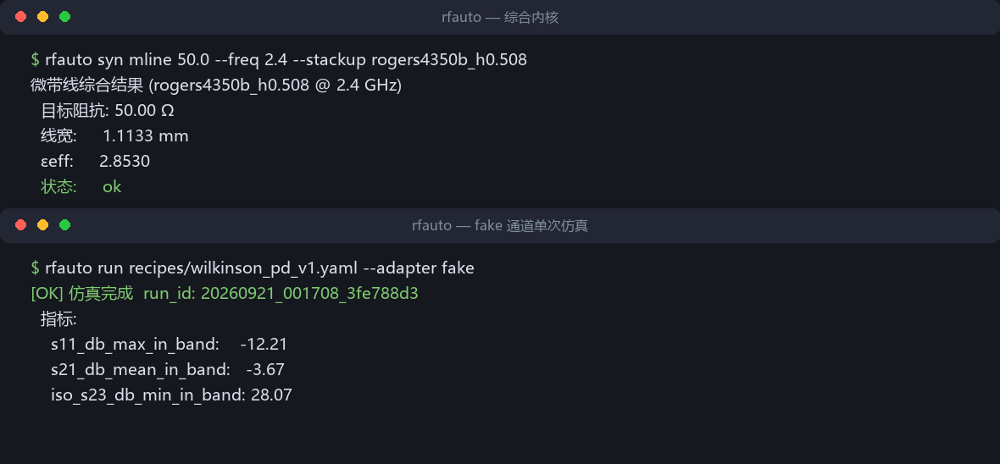
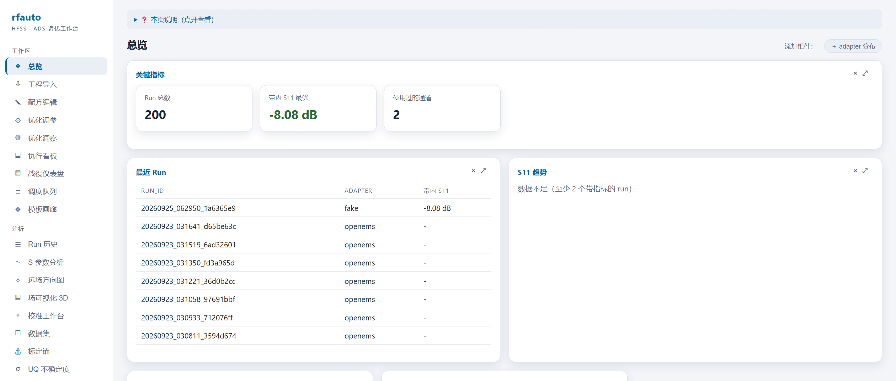
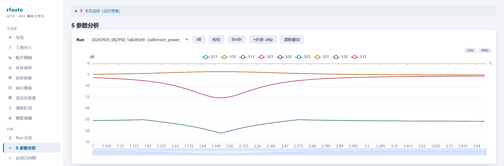
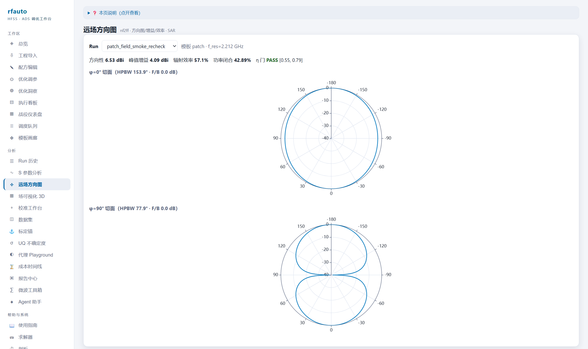
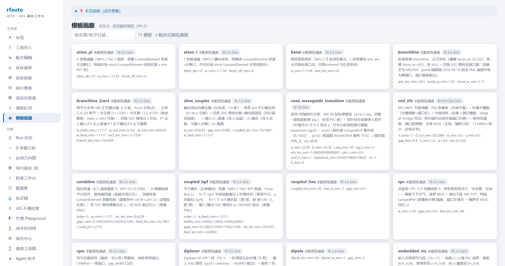

<p align="center">
  
</p>

# rfauto

[]()
[]()
[]()
[]()

English | [简体中文](README.zh-CN.md)

**rfauto is an automation framework for RF/microwave design and simulation.**
Describe a device, get a first-cut geometry from physics formulas, simulate it
with whichever solver you have, check the result for numerical artifacts, and
let an optimizer tune the dimensions — with AI assistants allowed to drive the
whole pipeline through MCP, under one hard rule:

> **Every physical number (frequency, loss, geometry) is produced by a
> deterministic kernel or solver — never by the LLM.**

It drives **16 EM/EDA engines** behind one interface, ships
**72 parameterized device templates** with built-in physics checks, and
exposes **274 CLI commands** and **152 MCP tools** (+10 resources) — kept
honest by **27000+ unit tests** that run without any commercial license.

<!-- numbers-start（check_numbers 门控锚；实测注入，勿手改数字） -->
`CALCULATOR_REGISTRY 329 (with experimental 330)` · `TEMPLATE_META 72` ·
`EXPECTED_TEMPLATES 72` · `ANCHORS 87` · CLI commands 274 (leaves) ·
(152 MCP tools + 10 resources)
<!-- numbers-end -->

**Contents** · [Why](#why) · [What it does](#what-it-does) ·
[Trust layer](#the-trust-layer) · [Quick start](#quick-start) ·
[The Web UI](#the-web-ui) · [Engines](#engines) · [Docs](#documentation) ·
[Roadmap](#status--roadmap) · [Contributing](#contributing)

<p align="center">
  
</p>

> Note: numbers shown inside the diagrams above and below are historical
> snapshots; for live counts run `rfauto doctor` or `scripts/check_numbers.py`.

## Why

RF simulation work is full of manual repetition and quiet traps:

- Every iteration means redrawing geometry, re-running a solver that takes
  minutes to hours, and reading numbers out by hand.
- Each vendor tool has its own API and quirks; switching engines means
  rewriting your workflow.
- Solvers fail silently in confusing ways — a bad mesh or a wrong port can
  produce plausible-looking garbage.
- The good solvers need expensive licenses; the free ones deserve distrust
  until verified.

rfauto turns that loop into code: templates build the geometry, adapters talk
to the engines, quality gates judge the results, optimizers close the loop,
and every reported number carries its provenance.

## What it does

- **One interface, many engines** — HFSS, ADS, openEMS, COMSOL, Elmer,
  NGSolve, Meep, Icepak, Q3D, Palace, KiCad, ngspice, FDTDX (JAX), MMT
  (analytic modal), QucsatorRF and VNA behind a common adapter layer. Commercial engines stay opt-in extras; everything
  core runs against a built-in fake solver, so you can try the whole framework
  with zero licenses.
- **Device template factory** — 72 parameterized families (couplers, power
  dividers, filters, antennas, transitions…). Each template synthesizes
  starting dimensions from closed-form physics, and registers acceptance
  checks so you can tell "real result" from "mesh artifact".
- **Optimization loops** — TPE, CMA-ES and multi-objective NSGA-II, with a
  surrogate-model path: fit a cheap model from a batch of solves, then search
  the model instead of re-solving. Batch campaigns run unattended with budget
  admission, quotas and watchdogs.
- **Quality gates everywhere** — energy and passivity checks, grid-artifact
  diagnostics, cross-engine arbitration (compare the same geometry on a second
  solver), and physics-invariant tests. A result that fails a gate is reported
  as failed, never silently passed.
- **AI that drives but doesn't invent** — a full MCP server so Claude Desktop,
  Cursor or your own agent can operate the framework. Agent edits go through a
  sandbox draft and validation gates before they touch your workspace.

Newest additions: an **EDB layout fast lane** for planar devices — declarative
emitters synthesize the layout spec from closed-form physics, every solve
point runs as an independent short-lived `ansysedt -BatchSolve` process (no
long-lived desktop session to poison), a second `-batchextract` pass exports
Touchstone, and a seven-factor health gate judges each artifact before it can
reach a dataset. Alongside it: a **TRL/SOLT calibration kernel** that
recovers two-port error boxes from raw standards measurements, and the
one-shot HFSS batch base that drives the whole chain from a single entry
point.


(The counts rendered inside this diagram are a historical snapshot; see the
note above the architecture figure.)

## The trust layer

The part we care about most: how do you know a simulation result is
*believable*? rfauto treats that as a first-class feature — health gates on
every run, reference responses per template, deterministic kernels for every
number, and a sandbox-plus-gates path for anything an AI agent wants to change.


<!-- AUTO-NUMBERS:START（scripts/sync_readme_numbers.py 生成，勿手改） -->
<!-- PR-13a：由 scripts/sync_readme_numbers.py 从 check_numbers 同源计数生成；漂移修复=仓根重跑 `python scripts/sync_readme_numbers.py --write` 并同笔提交（#97） -->

**Scale numbers**: MCP tools 152 (+10 resources) | CLI commands 274 (leaves) | CALCULATOR_REGISTRY 329 [with experimental 330] | device templates 72 | anchors 87
<!-- AUTO-NUMBERS:END -->

## Quick start

**Prereq:** Python 3.10–3.12 (`python --version` to check). No commercial
tools needed — the built-in fake solver covers the whole core. Six steps
below: install → check the machine → a zero-license smoke run → read the
run → open the workbench → real physics.

### 1. Install

```bash
git clone https://github.com/geer1895/rfauto && cd rfauto
python -m venv .venv
.venv\Scripts\activate               # Linux/macOS: source .venv/bin/activate
pip install -e ".[ui]"               # core + browser workbench
```

`rfauto --help` prints the command table once the install lands. Core-only
(`pip install -e .`) covers steps 2–4; `rfauto ui` needs the `[ui]` group
(starlette/uvicorn — without it the command exits with ImportError).

### 2. Check the machine (seconds)

```bash
rfauto doctor
```

Prints the Python/AEDT/ADS versions and paths it found on this machine.
AEDT detection reads the install directory and is labeled `best_effort` —
never presented as verified; ADS reports `verified` only after a live
handshake. `rfauto doctor --janitor --min-free-gb 8` adds the leftover-
process panel (orphan `ansysedt` inventory + AEDT project locks) and a
memory gate.

### 3. First pipeline run, zero license

```bash
$ rfauto run recipes/wilkinson_pd_v1.yaml --adapter fake
✓ 仿真完成  run_id: 20260921_001708_3fe788d3
  指标:
    s11_db_max_in_band: -12.21
```

fake is a closed-form analytic stand-in, not an EM simulation — it exists
to exercise the whole chain (recipe → run → artifacts → gates) in seconds
without touching a license. Real physics comes in step 6 with openEMS or
HFSS; recipes and quality gates stay the same.

### 4. Read the run

Every run lands in `runs/<timestamp>_<hash>/`:

- `meta.json` — environment fingerprint (git sha, numpy/BLAS, pip-freeze
  hash): your reproduction credentials
- `recipe.snapshot.yaml` — the recipe as-run; `rfauto replay <run_id>`
  re-runs it verbatim
- `report.md` and `results/` — metrics and figures; real-solver runs add
  Touchstone files

Freshness check (manifest closing fingerprint vs files on disk; verdicts
fresh/stale/legacy):

```bash
rfauto runs verify <run_id>
```

`stale` — an old file standing in for a new run — exits 1 instead of
passing silently.

### 5. Open the workbench

```bash
rfauto ui --port 8643        # default 8642; switch ports when an old instance holds it
```

Then open http://127.0.0.1:8643 (local only). **Runs** — every
simulation's metrics, curves and quality-gate verdicts. **Gallery** — 72
device templates, each card opens a plain-language parameter table (what
it is, what the numbers mean, where they come from). **Tune** — the same
loop as step 3 from the browser: keep the adapter on **fake**, press
**Start** — 10 trials on the Wilkinson divider finish in seconds and show
the recommended dimensions in a result card. **Tools** — 323 closed-form
calculators for instant cross-checks. Top-right **zh/EN** switches the
whole workbench.

The terminal path works without any browser — the closed-form
synthesizer, for example:

```bash
$ rfauto syn mline 50.0 --freq 2.4 --stackup rogers4350b_h0.508
微带线综合结果 (rogers4350b_h0.508 @ 2.4 GHz)
  目标阻抗: 50.00 Ω
  线宽:     1.1133 mm
  εeff:     2.8530
```

### 6. Real physics

```bash
pip install -e ".[hfss]"     # pyaedt; needs AEDT 2025 R1
```

Switch the adapter to **openEMS** (free, build instructions in the docs)
or **HFSS** — same recipes, same quality gates. Before unattended HFSS
runs, read
[docs/unattended_hfss_automation.md](docs/unattended_hfss_automation.md) —
operations discipline from a year of real-machine runs. The three traps
that bite first:

- `Desktop(version=…, non_graphical=…, new_desktop=…)` — the constructor
  argument names are not the old `specified_version`;
- one `Hfss` instance per Desktop — a second instance's design-variable
  manager starts returning `None`;
- one failed boundary assignment poisons the whole session (metadata
  queries return `None`), the gRPC channel breaks with it, and
  `release_desktop` then fails silently — treat a poisoned session as
  rebuild-from-scratch, never continue on it.

Pre-flight gates: `rfauto doctor --janitor --min-free-gb 8`; keep project,
output and log paths absolute — a relative `-outdir` hangs
`Project.Rename` for minutes before failing. To run the test suite:
`pip install -e ".[dev]"` then `python -m pytest tests/unit -q`. Prefer
containers? Two commands under [Run in Docker](#run-in-docker) — the
image carries the open-source core (fake solver and deterministic
calculators), no commercial tools inside.



### Common first-run failures

| Symptom | Likely cause | Fix |
|---|---|---|
| `rfauto ui` won't open, or pages return 404 | port 8642 held by an older instance (old process, old code) | `rfauto ui --port 8643`; or check the command line, then kill the stale instance |
| AEDT fails writing files (STEP/exports) | non-ASCII (e.g. Chinese) characters in the path | keep project/work paths ASCII; write to an ASCII temp dir and copy back |
| HFSS won't connect / license errors | orphan `ansysedt` processes holding license seats | `rfauto doctor --janitor` lists them with parent-process evidence; review, then `--janitor-clean` |
| solve killed mid-run / machine unresponsive | not enough free memory | `rfauto doctor --min-free-gb 8 --enforce` before launch; exits non-zero below the threshold |
| license server unreachable | probe target not set | set `RFAUTO_LICENSE_SERVER`, rerun `rfauto doctor` |
| fake results far off the real ones | fake is closed-form analytic, not an EM simulation | fake validates the chain only; switch the adapter to openEMS/HFSS — same recipes, same gates |
| run directory has no Touchstone | the fake channel emits analytic metrics only | see `results/metrics.json`; Touchstone comes from real-solver channels |
| on-disk Touchstone doesn't match the run record | an old file was copied over the new one | `rfauto runs verify <run_id>` — stale exits 1, never passes silently |

### Why trust the results?

Every simulation result carries its provenance: which solver produced it,
which formulas derived the geometry, and which quality gates it passed.
79 calibration anchors — each cross-validated between HFSS (reference) and
openEMS (free) — cover the template library, and the gallery shows an
arbitration badge on every template that has been dual-engine verified.
When two engines agree on the same physics, you can trust the third (free)
one for parameter sweeps.

From there, the usual loop:

```bash
rfauto sweep recipes/wilkinson_pd_v1.yaml --adapter fake   # parameter sweep
rfauto tune  recipes/wilkinson_pd_v1.yaml --max-trials 60  # optimization loop
rfauto replay <run_id>                                     # reproduce a past run
```

### Connect an AI assistant (optional)

```bash
pip install -e ".[mcp]"
python -m rfauto.mcp_server        # stdio transport; 152 tools (+9 resources)
```

Then register it in your MCP client (Claude Desktop example):

```json
{
  "mcpServers": {
    "rfauto": {
      "command": "python",
      "args": ["-m", "rfauto.mcp_server"],
      "cwd": "/path/to/rfauto"
    }
  }
}
```

## Run in Docker

The repo ships a `Dockerfile`; CI builds it and smoke-tests the container on
every push and PR. Local use is two commands:

```bash
docker build -t rfauto:local .
docker run --rm rfauto:local   # entrypoint smoke: prints the CLI help
```

The image contains the open-source core only — no commercial tools or
licenses included. For real runs, mount your work directory: add
`-v "$PWD:/work" -w /work` before the image name.

## The Web UI

`rfauto ui` opens a local review workbench — no data leaves your machine.
Inspect every run's metrics and curves, compare adapters, run the built-in
microwave calculators, and review AI-agent proposals before promoting them:

```bash
rfauto ui          # http://127.0.0.1:8642 — local only
```

| | |
|---|---|
|  |  |
|  |  |

Every page is deep-linkable (`#runs`, `#sparams`, `#tools`, …), so you can
bookmark the view you care about.

## Engines

| Engine | License | Typical role |
|---|---|---|
| HFSS (Ansys AEDT) | commercial | full-wave reference / arbitration |
| ADS (Keysight) | commercial | circuit & system co-simulation |
| openEMS | open (GPL, runs in a subprocess) | fast FDTD batch solving |
| COMSOL | commercial | FEM multiphysics |
| Elmer | open | multiphysics FEM |
| NGSolve | open | frequency-domain FEM |
| Meep | open | FDTD (Linux) |
| Icepak / Q3D (Ansys) | commercial | thermal / field extraction |
| Palace | open | parallel FEM |
| KiCad | open | PCB DRC & layout extraction (subprocess) |
| ngspice | open | circuit simulation |
| FDTDX (JAX) | open | differentiable FDTD |

Commercial tools need your own valid license; the framework neither includes
nor circumvents any license, and no vendor-proprietary content is distributed
in this repository (see [THIRD_PARTY_NOTICES.md](THIRD_PARTY_NOTICES.md)).

## Documentation

- [Templates reference](docs/rf_template_references.md) — per-template
  acceptance values and modeling rules
- [openEMS build guide](docs/openems_build_guide.md)
- [COMSOL notes](docs/comsol_references.md) · [Migration guide](docs/migration_guide.md)
- [Template metadata](docs/templates/) — one `meta.yaml` per device family
- [Changelog](CHANGELOG.md) · [Contributing](CONTRIBUTING.md)

## Status & roadmap

rfauto is a working tool, not a demo: the core chain (template → synthesis →
solve → quality gates → optimization → report) runs on real HFSS, ADS,
openEMS, COMSOL and KiCad installs, backed by the test suite above. It is
Windows-first today, single-maintainer, and moving toward Linux/Docker
friendliness.

Planned next, in the open:

- **Datasets & benchmarks** — the simulation datasets collected by the
  built-in data-factory pipeline and the agent evaluation sets are not part
  of this repository yet; we plan to release them progressively, and would
  love collaborators to help shape and curate them.
- **Methodology paper** — a write-up of the quality-gate / deterministic-
  kernel methodology is planned; contributions and co-authoring welcome.
- **More device families, more engines, better onboarding** — all good first
  issues.

If any of this sounds interesting to you, open an issue — we'd like this to
become a community project, not a solo archive.

## Contributing

Issues and pull requests are welcome — see
[CONTRIBUTING.md](CONTRIBUTING.md) for the quick start, project rules and
the meaning of the `#NNN` markers in code comments.

## Citation

If rfauto helps your research, please cite it — see
[CITATION.cff](CITATION.cff).

## License

rfauto is licensed under **GPL-3.0-only** (see [LICENSE](LICENSE)).
Third-party package licenses are listed in
[THIRD_PARTY_NOTICES.md](THIRD_PARTY_NOTICES.md). Note that the optional
openEMS adapter drives GPL-licensed openEMS through a separate subprocess;
the openEMS bindings themselves are not included in this repository and are
built from the official openEMS source by the user.
