<p align="center">
  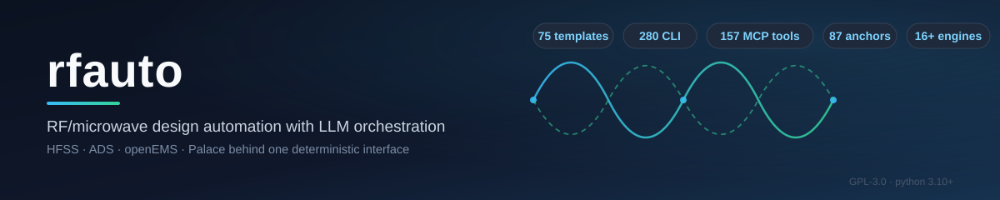
</p>

# rfauto

[]()
[]()
[]()
[]()

English | [简体中文](README.zh-CN.md)

**rfauto turns RF/microwave design from "draw, wait for the solver, copy
numbers" into one reproducible automated loop.** Describe the device you want; it
derives first-cut dimensions from closed-form physics, drives whichever solver you
have, runs every result through quality gates that catch numerical artifacts, then
optimizes the dimensions — and hands you a report where every number carries its
provenance. AI assistants can drive all of it over MCP, under one iron rule:

> **Every physical number (frequency, loss, geometry) is produced by the
> deterministic kernel or by a solver — never invented by the language model.**

Measured counts for this revision (exact; verifiable with `scripts/check_numbers.py`):

<!-- numbers-start（check_numbers 门控锚；实测注入，勿手改数字） -->
`CALCULATOR_REGISTRY 340 (with experimental 341)` · `TEMPLATE_META 75` ·
`EXPECTED_TEMPLATES 75` · `ANCHORS 87` · CLI commands 280 (leaves) ·
(157 MCP tools + 10 resources)
<!-- numbers-end -->

<!-- AUTO-NUMBERS:START（scripts/sync_readme_numbers.py 生成，勿手改） -->
<!-- PR-13a：由 scripts/sync_readme_numbers.py 从 check_numbers 同源计数生成；漂移修复=仓根重跑 `python scripts/sync_readme_numbers.py --write` 并同笔提交（#97） -->

**Scale numbers**: MCP tools 157 (+10 resources) | CLI commands 280 (leaves) | CALCULATOR_REGISTRY 340 [with experimental 341] | device templates 75 | anchors 87
<!-- AUTO-NUMBERS:END -->

**Contents** · [Capability map](#1-capability-map-nine-domains) · [Quick start](#quick-start) ·
[Why trust it](#3-why-these-results-can-be-trusted) · [Engine ladder](#4-engine-ladder-and-arbitration) ·
[Architecture](#5-architecture) · [Docs map](#6-docs-map) · [Roadmap](#7-status-and-roadmap)

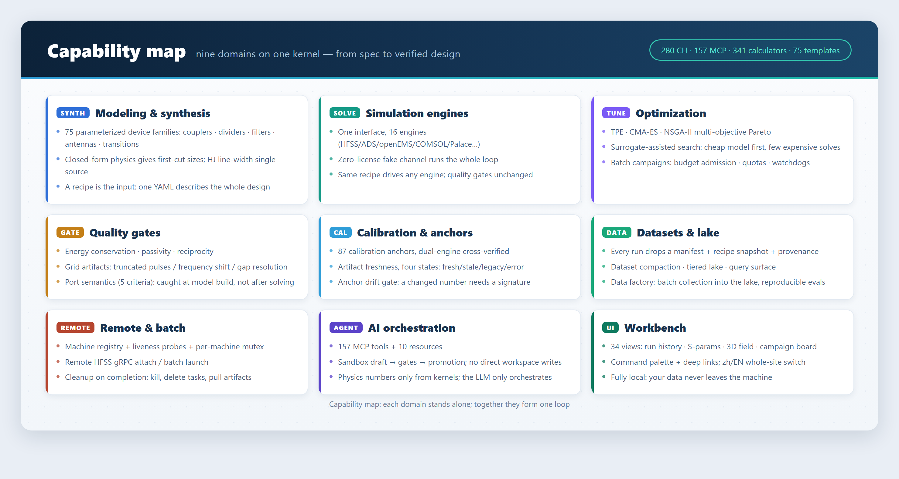

---

## 1. Capability map (nine domains)

Each domain works on its own; together they form the loop above. Every command
below is copy-pasteable.

### 1.1 Device modeling and synthesis

**75 parameterized device templates** — dividers, couplers, filters, antennas,
transitions, lumped IPD passives. Each template synthesizes first-cut dimensions
from closed-form physics and registers the acceptance criteria for that family, so
you can tell a real result from a grid artifact. Line widths are never copied from
a document: they come from skrf Hammerstad-Jensen synthesis (single source).

```bash
rfauto syn mline 50.0 --freq 2.4 --stackup rogers4350b_h0.508
#  width: 1.1133 mm    eps_eff: 2.8530
rfauto templates list                  # the 75 families and their parameters
rfauto templates golden-diff           # geometry golden regression
```

A recipe is the input: one YAML file describes frequency, substrate, targets and
constraints, and every channel reads the same file.

### 1.2 Multi-engine simulation

One adapter layer, 16 channels: HFSS, ADS, openEMS, COMSOL, Elmer, NGSolve, Meep,
Icepak, Q3D, Palace, KiCad, ngspice, FDTDX (JAX), MMT (analytical mode-matching),
QucsatorRF, and a VNA measurement channel. Commercial engines are optional extras;
**the whole core runs on the built-in fake channel — no license needed to try
everything.**

```bash
rfauto solvers list                    # registered channels and availability
rfauto run recipes/patch_antenna_v1.yaml --adapter fake
```

### 1.3 Optimization and tuning

TPE / CMA-ES / NSGA-II for multi-objective work (Pareto fronts), plus a surrogate
route: fit a cheap model on a batch of results, search on the model, and spend
expensive solves only where they matter. Batch campaigns carry budget admission,
quotas and watchdogs, so they can run unattended overnight.

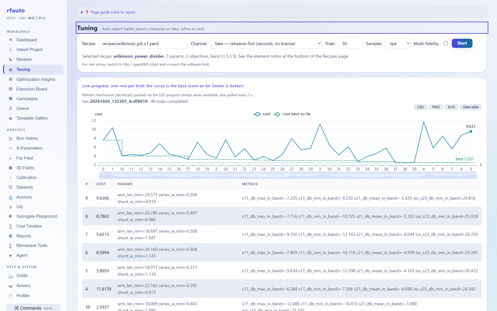

```bash
rfauto tune  recipes/wilkinson_pd_v1.yaml --adapter fake --max-trials 40
rfauto sweep recipes/wilkinson_pd_v1.yaml --adapter fake
rfauto campaign plan --config campaign.yaml
```

### 1.4 Quality gates

Solvers fail *quietly*: a coarse mesh shifts the resonance, a wrong port solves to
±0 dB, a truncated pulse pushes |S11| above 1 — and the garbage looks as plausible
as the truth. rfauto makes the judgment an explicit gate.

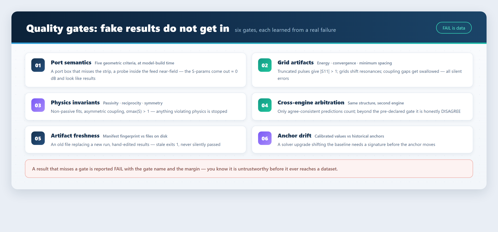

Six gates cover six classes of failure: port semantics (five geometric criteria at
model-build time), grid artifacts (energy / convergence / minimum spacing),
physics invariants (passivity / reciprocity / symmetry), cross-engine arbitration
(a second engine on the same structure), artifact freshness (manifest fingerprint
vs files on disk), and anchor drift. **A result that misses a gate is reported
FAIL with the gate name and the margin — never silently passed.**

### 1.5 Calibration and anchors

**87 calibration anchors** cover 68 device families (75 templates ship; families
without an anchor say so). Layered by evidence strength: **18 are backed by an
HFSS ↔ openEMS dual-engine comparison**, 2 by HFSS/MMT arbitration, 1 by HFSS
self-consistency; 62 are closed-form or quasi-static FD reference anchors (59
closed-form + 3 FD, each with formula source and validity domain on file); the
remaining 4 have no engine comparison and say so — a closed-form anchor is never
dressed up as engine-backed.
Artifact freshness has four states (fresh/stale/legacy/error): an old file
replacing a new run is flagged, and `rfauto runs verify` exits 1.

```bash
rfauto anchors list                    # values / status / provenance
rfauto anchors validate                # check provenance records one by one
rfauto runs verify <run_id>            # freshness (stale ⇒ exit code 1)
```

### 1.6 Datasets and the lake

Every run drops a self-describing directory: environment fingerprint, recipe
snapshot, metrics, figures, Touchstone files, and a manifest recording hashes of
all artifacts. Datasets assemble runs into a queryable lake with tiered
compaction and batch collection.

```text
runs/20261026_132409_ff7c0bde/
├── meta.json              # environment fingerprint (versions, git sha, deps)
├── recipe.snapshot.yaml   # the recipe snapshot this run used (replay reads it)
├── manifest.json          # SHA256 + size of every artifact (freshness basis)
├── report.md              # human-readable report: metrics, gates, verdict
└── results/
    ├── metrics.json       # machine-readable metrics
    ├── params.s3p         # Touchstone (real-engine channels only)
    └── figs/              # figures
```

```bash
rfauto runs list
rfauto dataset materialize --help
rfauto lake index
```

### 1.7 Remote execution and batch

A machine registry with liveness probes and per-machine mutex: send the heavy work
to a compute server and keep only orchestration locally. Remote HFSS runs over
gRPC attach; batch jobs launch short-lived processes. Everything is cleaned up on
completion (processes killed, scheduled tasks removed, artifacts pulled back) so
no orphan holds a license seat.

```bash
rfauto remote probe                    # liveness and version check
rfauto remote status
```

### 1.8 AI orchestration (MCP)

**157 MCP tools** and 10 resources: Claude Desktop, Cursor or your own agent can
operate the framework. Agent changes land in a sandbox draft and must pass
validation gates before touching the workspace; the agent emits typed tool calls
only, and the kernel fills in the physics.

```bash
pip install -e ".[mcp]"
python -m rfauto.mcp_server            # stdio transport
```

### 1.9 Workbench

`rfauto ui` starts a local review workbench (your data never leaves the machine):
24 views over run history, S-parameters, 3D fields, the template gallery, campaign
boards, calibration, datasets, reports and a microwave toolbox. Command palette
(Ctrl+K), deep links, whole-site zh/EN switch.

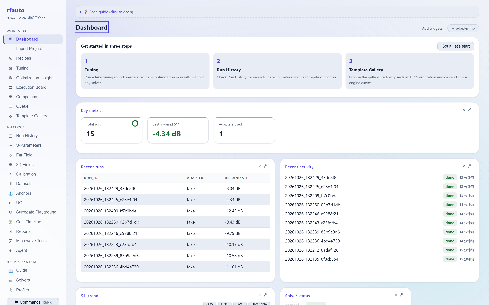

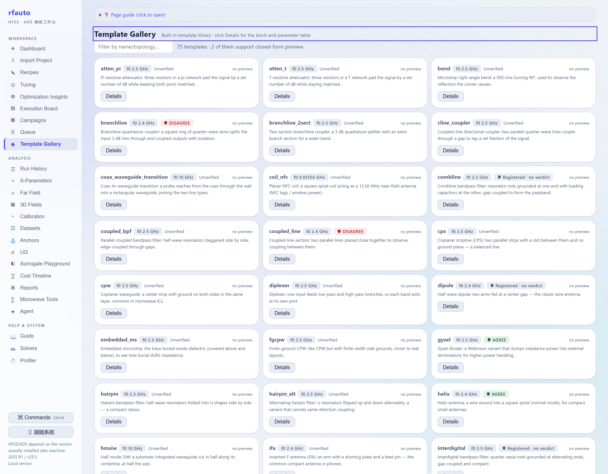

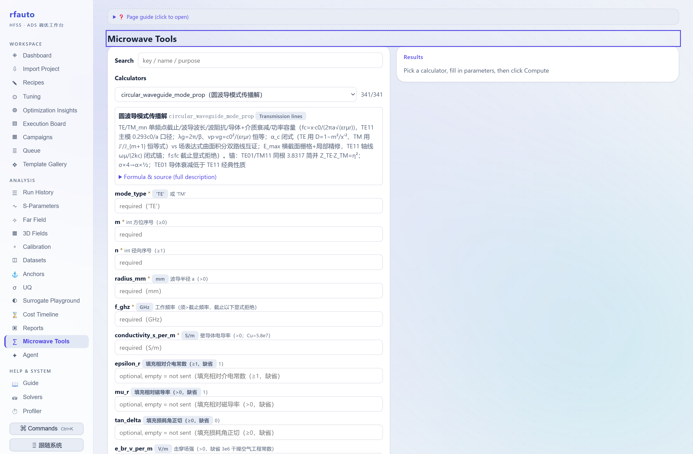

---

## Quick start

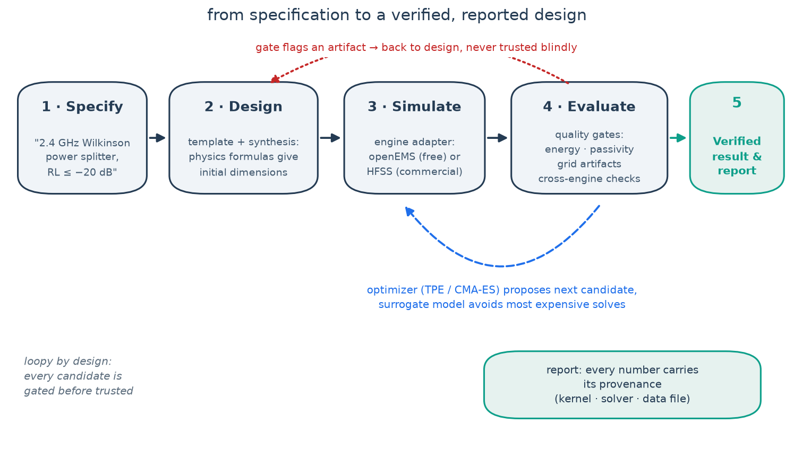

**Requirements**: Python 3.10–3.12 (`python --version`). No commercial tool is
needed — steps 0–6 run entirely license-free in about ten minutes.

### Step 0 · Get the code

```bash
# A. with git (recommended, easy to update)
git clone https://github.com/geer1895/rfauto && cd rfauto

# B. without git: use Code → Download ZIP on GitHub, or grab
#    "Source code (zip)" from the Releases page and unzip it
```

### Step 1 · Install

```bash
python -m venv .venv
.venv\Scripts\activate                  # Linux/macOS: source .venv/bin/activate
pip install -e ".[ui]"                  # core + browser workbench
rfauto --help                           # a command table means it works
```

Steps 2–6 only need the core (`pip install -e .`); `rfauto ui` needs the `[ui]`
extra (starlette/uvicorn); the test suite needs `[dev]`.

### Step 2 · Health check

```bash
rfauto doctor
```

Returns a table in a second: Python version, AEDT/ADS detection (marked "not
configured" if absent — the license-free flow is unaffected), cache mode. Add
`--janitor --min-free-gb 8` to also list orphan solver processes and enforce a
memory floor — worth doing before long real-engine runs.

### Step 3 · First simulation (no license)

```bash
rfauto run recipes/wilkinson_pd_v1.yaml --adapter fake
```

Measured output on the development machine (2.4 GHz Wilkinson divider, Rogers
4350B 0.508 mm):

```text
✓ done  run_id: 20261026_132409_ff7c0bde
  metrics:
    s11_db_max_in_band: -12.4325
    s11_db_min_in_band: -16.2978
    s21_db_mean_in_band: -3.5887
    iso_s23_db_min_in_band: 27.3788
```

The fake channel is a closed-form analytical model, not an EM solve — its job is
to exercise "recipe → run → artifacts → gates" in seconds. Real physics starts at
step 7, with the same recipe and the same gates.

### Step 4 · Read the artifacts

Each run lands in `runs/<timestamp>_<hash>/` (layout in
[1.6](#16-datasets-and-the-lake)). Look at `report.md` (human) and
`results/metrics.json` (machine), then verify freshness:

```bash
rfauto runs verify 20261026_132409_ff7c0bde
```

`fresh` means the files on disk still match the closing fingerprint; `stale` (an
old file replacing a new one) exits 1 and is never silently passed.

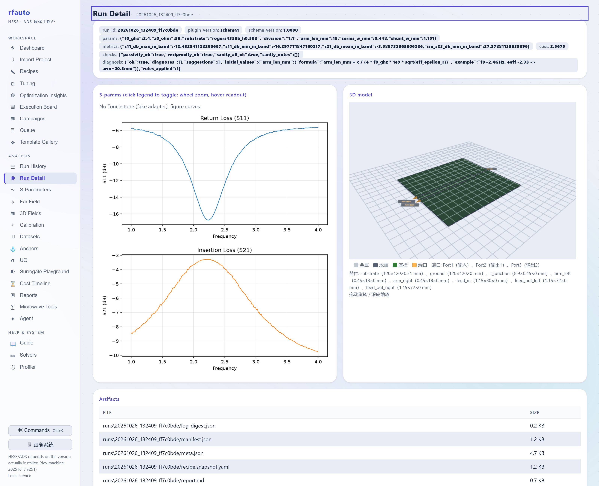

### Step 5 · Open the workbench

```bash
rfauto ui                 # http://127.0.0.1:8642, loopback only
rfauto ui --port 8643     # use another port if a stale instance holds 8642
```

The left rail is the workspace: **Dashboard**, **Run History**, **S-Parameters**,
**Template Gallery**, **Microwave Tools** (341 calculators), **Calibration**,
**Datasets**… The zh/EN switch sits at the top right.

### Step 6 · Tune one round

```bash
rfauto tune recipes/wilkinson_pd_v1.yaml --adapter fake --max-trials 40
```

Measured: 40 trials in about 46 s, cost dropping from 3.64 to 2.55, with the
recommended λ/4 arm 18.00 mm, 70.7 Ω arm width 0.448 mm and 50 Ω feed 1.151 mm
(`s11_db_max_in_band` improves from −11.46 to −12.45 dB). The **Tuning** view in
the workbench lets you watch it trial by trial.

### Step 7 · Switch to a real engine

```bash
pip install -e ".[hfss]"        # pyaedt; requires AEDT 2025 R1
# or build openEMS (free) following docs/openems_build_guide.md
```

Replace `--adapter fake` with `--adapter openems` or `--adapter hfss` — the recipe
and the gates do not change. Before unattended HFSS runs, read
[docs/unattended_hfss_automation.md](docs/unattended_hfss_automation.md), the
operational discipline distilled from a year of real-machine work. The three that
bite first:

- one `Hfss` instance per Desktop — a second one starts returning `None` from the
  design-variable manager;
- one failed assignment poisons the whole session (the gRPC channel breaks and
  `release_desktop` fails silently) — rebuild the session, never continue on a
  poisoned one;
- project / outdir / log paths must be absolute — a relative `-outdir` makes
  `Project.Rename` hang for minutes before failing.

### Step 8 · Command cheat sheet

```bash
rfauto run <recipe> --adapter fake|openems|hfss   # one run
rfauto tune <recipe> --max-trials 60              # outer optimization loop
rfauto sweep <recipe>                             # parameter sweep
rfauto replay <run_id>                            # reproduce a historical run
rfauto templates list | gallery | golden-diff     # templates and geometric goldens
rfauto anchors list | validate                    # anchor registry
rfauto runs list | verify <run_id>                # runs and freshness
rfauto em doctor | diff | metrics | sweep         # EM semantics layer
rfauto ui                                         # workbench
```

### First-run troubleshooting

| Symptom | Likely cause | Fix |
|---|---|---|
| `rfauto ui` won't open, or pages 404 | port 8642 held by an old instance (old code) | `rfauto ui --port 8643`; or check the command line and remove the old instance |
| `rfauto: command not found` | venv not activated, or install failed | re-`activate`; verify with `rfauto --help` after `pip install -e .` |
| AEDT fails to write files (STEP/export) | non-ASCII characters in the path | use ASCII project/work directories; stage into an ASCII temp dir and copy back |
| HFSS cannot connect / license errors | orphan `ansysedt` holding a seat | `rfauto doctor --janitor` lists them; review, then `--janitor-clean` |
| solve killed midway, machine sluggish | not enough free memory | `rfauto doctor --min-free-gb 8 --enforce` before launching |
| fake results differ a lot from hardware | fake is a closed-form model, not an EM solve | fake only validates the pipeline; switch to openEMS/HFSS — same recipe, same gates |
| no Touchstone in the run directory | the fake channel only emits analytical metrics | read `results/metrics.json`; Touchstone comes from real engines |
| Touchstone on disk disagrees with the run record | an old file replaced the new one | `rfauto runs verify <run_id>` — stale exits 1 |

---

## 3. Why these results can be trusted

Every result carries provenance: which solver ran it, how the geometry was
derived, which gates it passed.

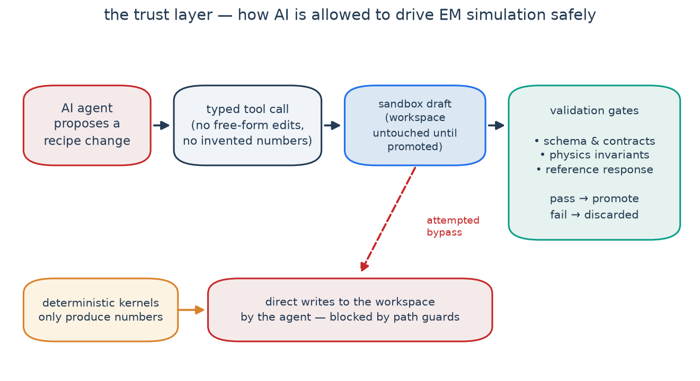

Three layers stack up:

1. **Numbers come only from the kernel.** Frequencies, losses and dimensions are
   either closed-form outputs or solver outputs, each with its formula source and
   validity domain; the LLM only orchestrates and explains.
2. **Results pass gates before they are trusted.** Six gates (see
   [1.4](#14-quality-gates)) cover everything from model-build to post-run; a miss
   is an honest FAIL with the margin.
3. **Every change leaves a trace.** Agent edits go sandbox draft → validation gates
   → promotion, and the promotion records who proposed it, which gates passed and
   the exact diff; anchor changes need a signature.

When two engines agree on the same physical structure, the free one can be trusted
for sweeps; beyond the pre-declared gate (|Δ| ≤ 0.5 dB and the same direction ⇒
AGREE) it is recorded honestly as DISAGREE — never rounded to green.

---

## 4. Engine ladder and arbitration

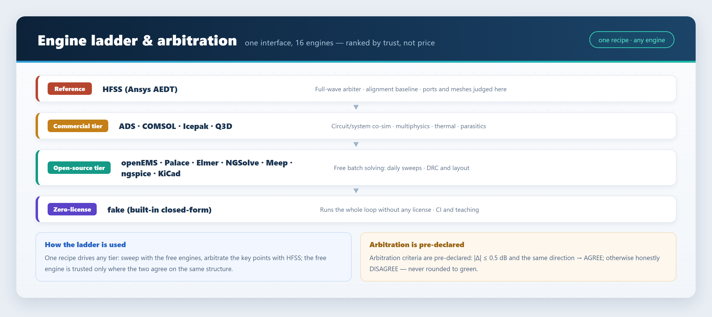

| Engine | License | Typical role |
|---|---|---|
| HFSS (Ansys AEDT) | commercial | full-wave reference / arbiter |
| ADS (Keysight) | commercial | circuit and system co-simulation |
| openEMS | open source (GPL, subprocess) | fast FDTD batch solving |
| COMSOL | commercial | FEM multiphysics |
| Elmer | open source | multiphysics FEM |
| NGSolve | open source | frequency-domain FEM |
| Meep | open source | FDTD |
| Icepak / Q3D (Ansys) | commercial | thermal / parasitic extraction |
| Palace | open source | parallel FEM |
| KiCad | open source | PCB DRC and layout extraction (subprocess) |
| ngspice / Xyce / QucsatorRF | open source | circuit simulation |
| FDTDX (JAX) | open source | differentiable FDTD |
| MMT | open source | analytical mode matching |
| VNA | — | measurement channel (sim-to-measurement correlation) |
| fake (built in) | project-owned | license-free pipeline checks / CI / teaching |

Commercial tools require your own valid license; the framework neither bundles nor
circumvents any license and ships no vendor-proprietary content (see
[THIRD_PARTY_NOTICES.md](THIRD_PARTY_NOTICES.md)).

---

## 5. Architecture

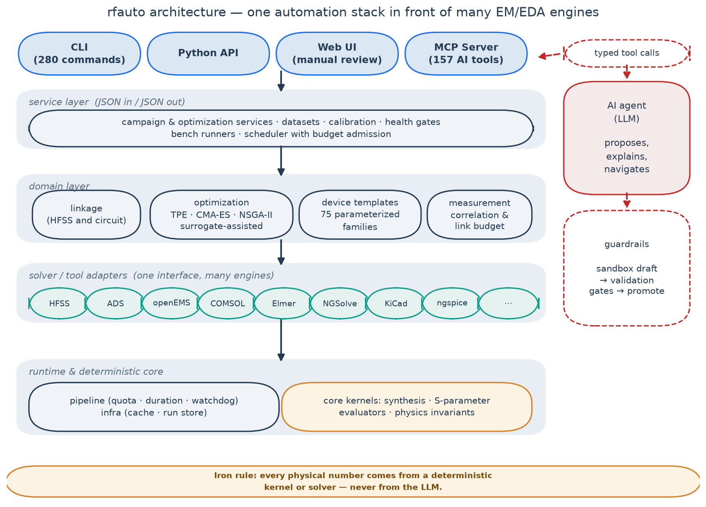

Dependencies only point downward and import-linter enforces it in the test gate (a
reverse import turns the build red):

```text
cli / mcp_server / ui  →  service  →  linkage / optimization / models
                                      →  adapters  →  pipeline  →  infra  →  core
```

- **The service layer speaks JSON**: features start as service functions; CLI, MCP
  and UI are thin shells;
- **Numbers live in the deterministic kernel** (`core/`, pure functions): the LLM
  or an agent never produces a physical number;
- **Replaceable parts are base class + registry**: `EMSolverAdapter` /
  `EMSolverRegistry`, `CALCULATOR_REGISTRY`, the device-template registry.

### Repository layout

```text
src/rfauto/
├── cli/            # command line (280 leaf commands)
├── mcp_server/     # MCP server (157 tools + 10 resources)
├── ui/             # browser workbench (24 views, zero-build native ESM)
├── service/        # business layer: JSON in, JSON out
├── linkage/        # HFSS ↔ circuit linkage
├── optimization/   # TPE / CMA-ES / NSGA-II / surrogates
├── models/         # recipes and device models
├── adapters/       # 16 engine/tool channels + template renderers
├── pipeline/       # run pipeline
├── infra/          # infrastructure (runs paths / cache / logging)
└── core/           # deterministic kernel: 341 calculators + physics criteria
```

### Calculators by domain

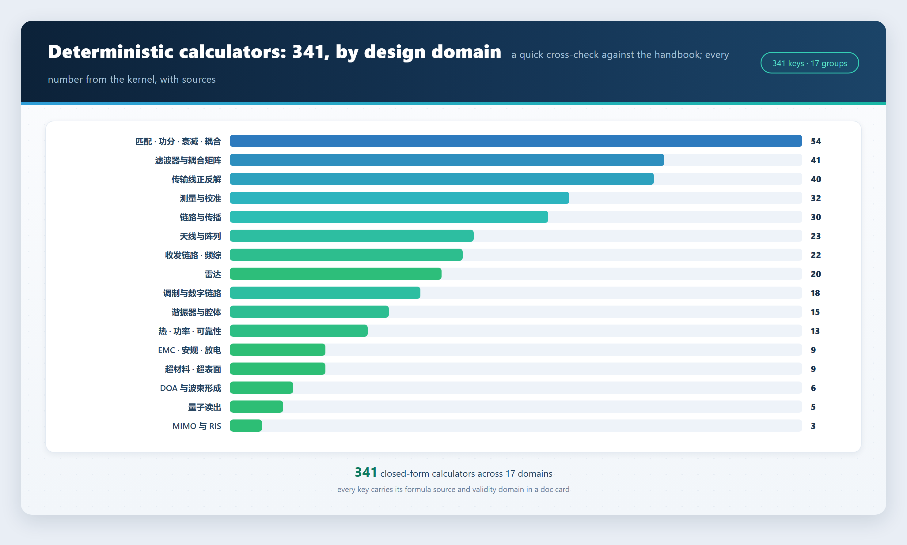

---

## 6. Docs map

**From zero**

- [Getting started](docs/tutorials/getting-started_en.md) — the first loop in ten minutes
- [Real simulation](docs/tutorials/real-simulation_en.md) — wiring up openEMS / HFSS
- [Workbench tour](docs/tutorials/ui_workbench_tour_en.md) — what the 24 views are for
- [First optimization loop](docs/tutorials/first_optimization_loop_en.md)
- [Campaign walkthrough](docs/tutorials/campaign-walkthrough_en.md)

**By topic**

- [Datasets and health gates](docs/tutorials/datasets_and_health_gates_en.md) · [Data factory](docs/tutorials/data_factory_en.md) · [Data lake](docs/tutorials/data_lake.md)
- [Measurement alignment](docs/tutorials/measurement-alignment_en.md) — making simulation and measurement agree
- [Uncertainty and surrogates](docs/tutorials/uncertainty_and_surrogates_en.md)
- [Verdict semantics](docs/tutorials/verdict_semantics_en.md) — what PASS/FAIL/PARTIAL/UNDECIDABLE mean
- [Remote solving](docs/tutorials/remote_server_en.md) · [DAG orchestration](docs/tutorials/dag_orchestration_en.md) · [Compose and league](docs/tutorials/compose_and_league.md)
- [Recast walkthrough](docs/tutorials/recast-walkthrough_en.md) · [MCP in practice](docs/tutorials/mcp_in_practice_en.md) · [Extending rfauto](docs/tutorials/extending-rfauto_en.md)

**Reference**

- [Template reference](docs/rf_template_references.md) — acceptance values and modeling rules per template
- [Calculator usage guide](docs/reference/calculator-usage.md) — keys organized by design flow
- [Anchor guide](docs/tutorials/anchor-guide_en.md) · [Environment variables](docs/env_vars.md) · [Envelope contract](docs/envelope_contract.md)
- [Template metadata](docs/templates/) — one `meta.yaml` per family

**Explanation and operations**

- [Layered architecture](docs/explanation/layered-architecture.md) · [Engine ladder and arbitration](docs/explanation/engine-ladder-and-arbitration.md)
- [Unattended HFSS discipline](docs/unattended_hfss_automation.md) · [openEMS build guide](docs/openems_build_guide.md)
- [COMSOL notes](docs/comsol_references.md) · [Migration guide](docs/migration_guide.md)
- [Changelog](CHANGELOG.md) · [Contributing](CONTRIBUTING.md)

**Container**: a `Dockerfile` ships at the repo root —
`docker build -t rfauto:local . && docker run --rm rfauto:local` smokes it; the
image contains only the open-source core, and mounting your workspace is enough to
run for real (`-v "$PWD:/work" -w /work`).

---

## 7. Status and roadmap

rfauto is a working tool, not a demo: the core loop (template → synthesis → solve
→ gates → optimize → report) has run on real HFSS, ADS, openEMS, COMSOL and KiCad
installations, backed by a test suite of the size above on both Windows (full) and
Linux CI. Development is Windows-first and single-maintainer; Linux support is
improving.

Planned next:

- **Datasets and benchmarks** — the simulation datasets and agent evaluation sets
  accumulated by the data-factory pipeline are not in this repository yet; we plan
  to publish them progressively and welcome co-maintainers;
- **A methodology paper** — on quality gates and the deterministic kernel;
  co-authors welcome;
- **More device families, more engines, a smoother first run** — all good first
  issues.

If any of that interests you, open an issue — the aim is a community project, not
one person's archive.

## Contributing

Issues and PRs are welcome — see [CONTRIBUTING.md](CONTRIBUTING.md) for how to get
started and what the `#NNN` markers in code comments mean.

## Citation

If rfauto helps your research, please cite it — see [CITATION.cff](CITATION.cff).

## License

rfauto is **GPL-3.0** (see [LICENSE](LICENSE)). Third-party dependency licenses are
listed in [THIRD_PARTY_NOTICES.md](THIRD_PARTY_NOTICES.md). The optional openEMS
adapter drives GPL openEMS in a separate process; this repository does not bundle
the openEMS bindings — build them from the official openEMS sources.
