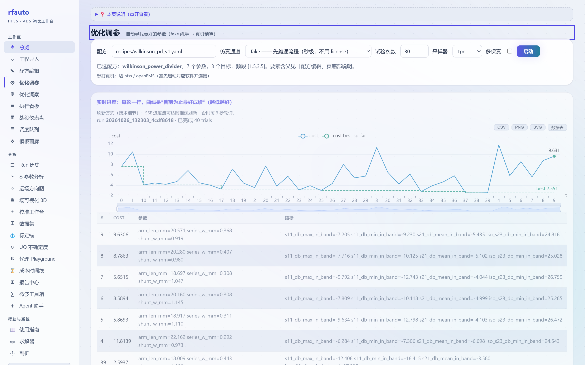
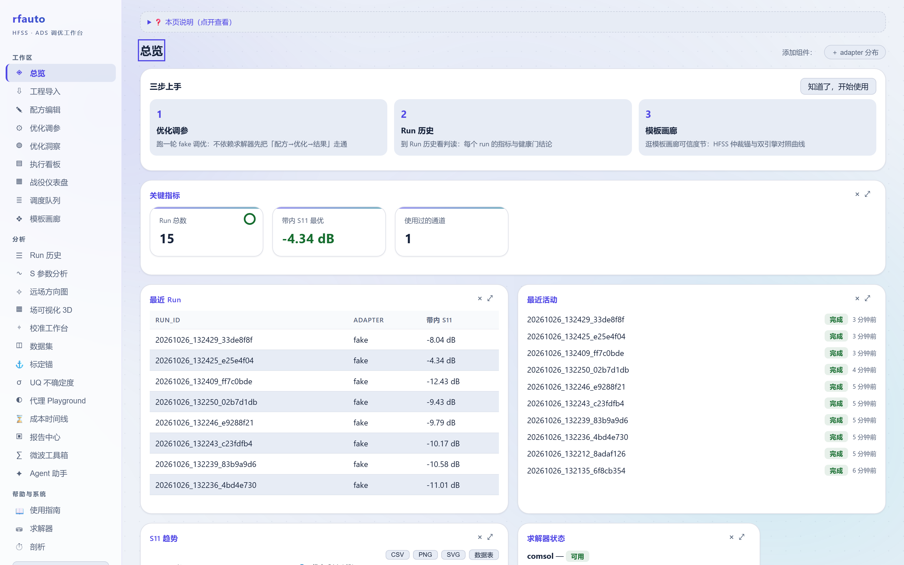
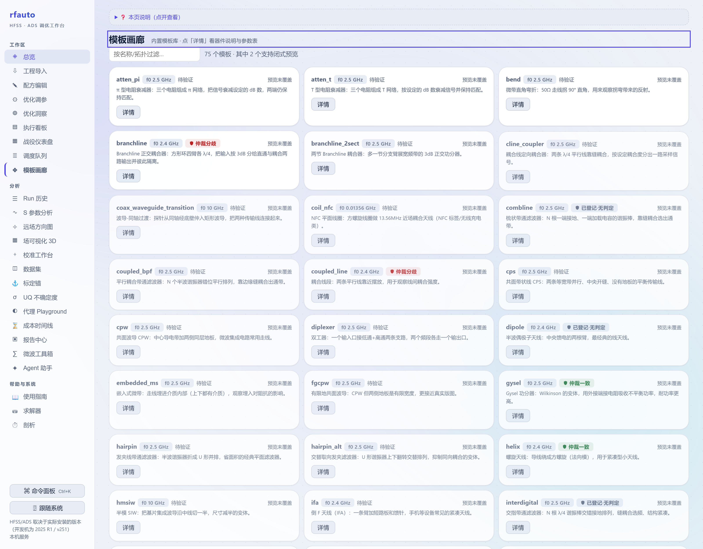
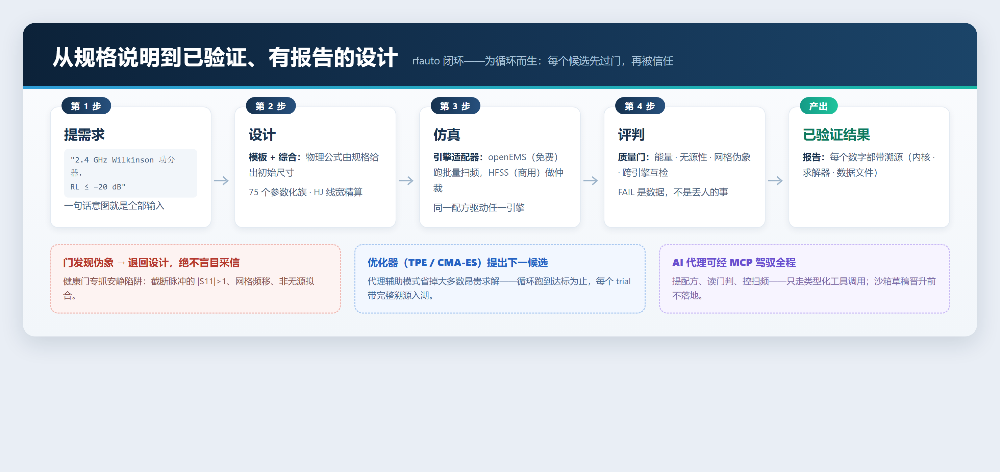
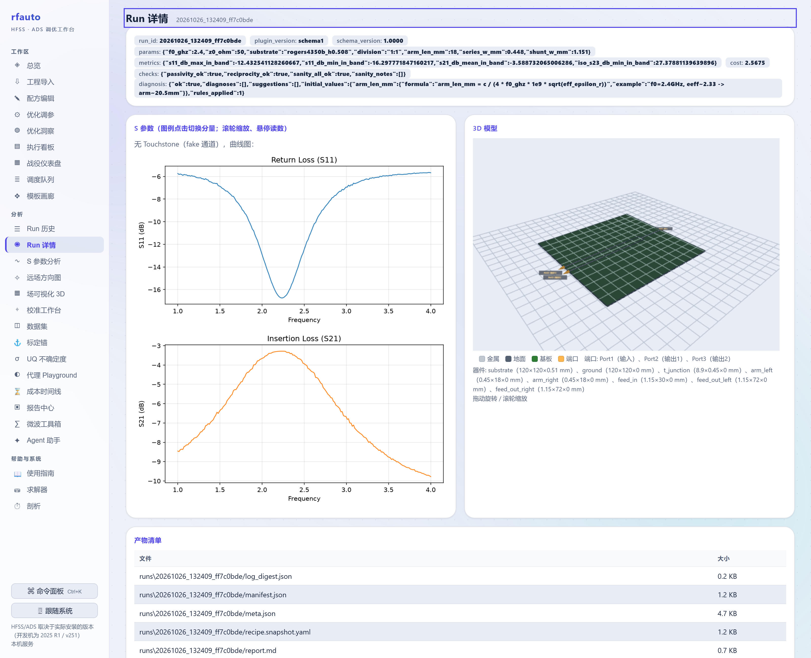
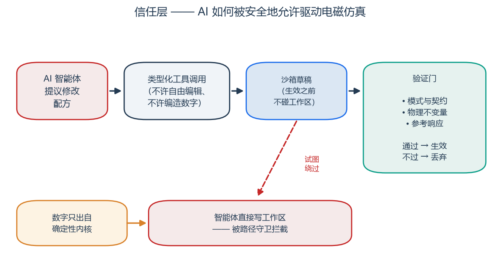
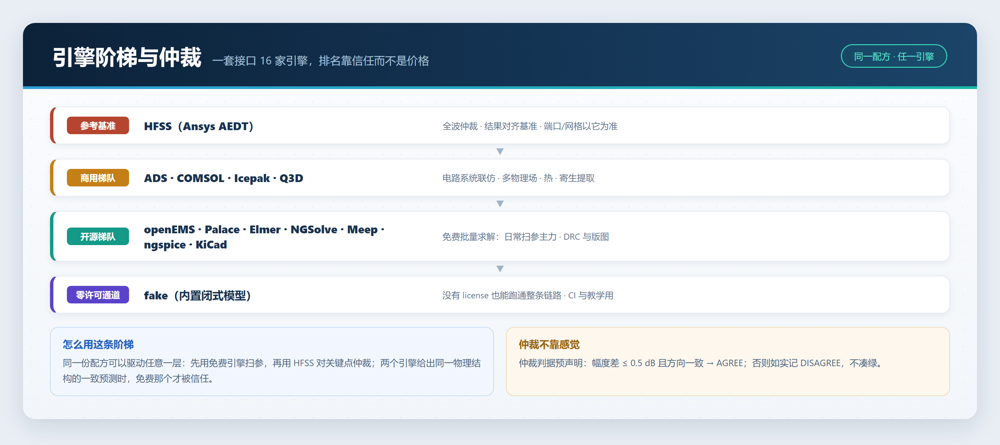
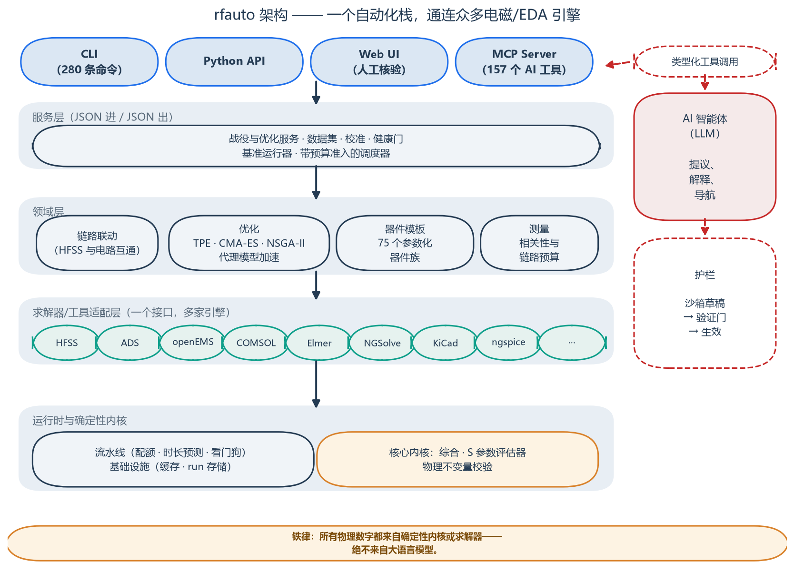
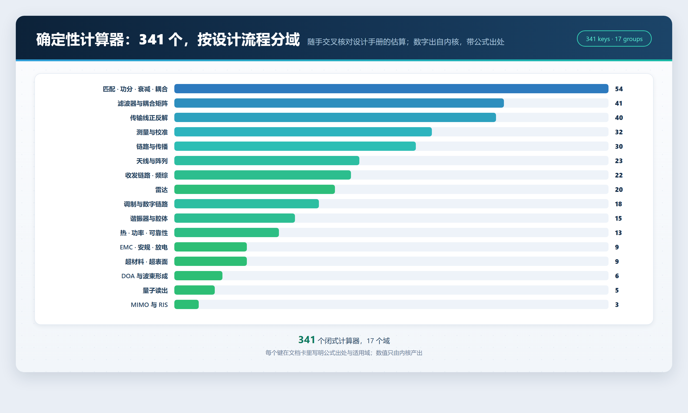

<p align="center">
  
</p>

# rfauto

[]()
[]()
[]()
[]()

[English](README.md) | 简体中文

**rfauto 把射频/微波设计从「画图—等求解—抄数字」变成一条可复现的自动化链路。**
你描述想要的器件，它用闭式物理给出第一版尺寸，调用你手头的求解器做仿真，逐道
质量门检查结果是不是数值假象，再用优化器把尺寸调到位，最后交一份每个数字都带
出处的报告。AI 助手可以通过 MCP 指挥整个流程——只有一条铁律：

> **所有物理数字（频率、损耗、几何尺寸）都由确定性公式内核或求解器产生，
> 永远不由大语言模型编造。**

它把 **16 个电磁/EDA 引擎**接到同一个接口后面，内置 **75 个参数化器件模板**和
**341 个闭式计算器**（340 常规 + 1 实验键），提供 **280 条 CLI 命令**和 **157 个 MCP 工具**（+10 个
resources），用 **87 个标定锚**和 **28000+ 条单元测试**兜底——这些测试不需要
任何商业许可就能跑。

本版实测计数（精确值，可用 `scripts/check_numbers.py` 复验）：

<!-- numbers-start（check_numbers 门控锚；实测注入，勿手改数字） -->
`CALCULATOR_REGISTRY 340 (with experimental 341)` · `TEMPLATE_META 75` · `EXPECTED_TEMPLATES 75` ·
`ANCHORS 87` · CLI 命令 280（叶子） · （157 个工具 + 10 个 resources）
<!-- numbers-end -->

**目录** · [功能全景](#一功能全景九个域) · [快速上手](#二快速上手八步跑通) ·
[为什么可信](#三为什么可以信这些结果) · [引擎阶梯](#四引擎阶梯与仲裁) ·
[架构](#五架构) · [文档地图](#六文档地图) · [路线图](#七现状与路线图)


---

## 一、功能全景（九个域）

每个域都能单独用；组合起来是那条完整链路。下面给出各自的「能干什么」与「怎么
开始」，命令可以直接复制。

### 1.1 器件建模与综合

**75 个参数化器件族**：功分器、耦合器、滤波器、天线、过渡结构、集总 IPD 无源
件……每个模板先用闭式公式综合出初始尺寸，并注册这个器件族的验收判据——让你分
得清「真结果」和「网格假象」。尺寸不是拍脑袋：线宽一律走 skrf Hammerstad-Jensen
精算（单源），不是从文档里抄毫米数。

```bash
rfauto syn mline 50.0 --freq 2.4 --stackup rogers4350b_h0.508
#  线宽: 1.1133 mm    εeff: 2.8530
rfauto templates list                  # 75 个族与各自参数
rfauto templates golden-diff           # 几何金样回归（改模板前后对比）
```

配方（recipe）就是输入：一份 YAML 描述频率、基板、目标与约束，所有通道读同一份
文件。

### 1.2 多引擎仿真

一个适配层、16 条通道：HFSS、ADS、openEMS、COMSOL、Elmer、NGSolve、Meep、
Icepak、Q3D、Palace、KiCad、ngspice、FDTDX(JAX)、MMT（解析模基）、QucsatorRF、
VNA 测量通道。商业引擎按需安装（可选依赖），**核心功能全部跑在内置 fake 通道
上——零许可就能体验整条链路**。

```bash
rfauto solvers list                    # 已注册通道与可用性（本机实测）
rfauto run recipes/patch_antenna_v1.yaml --adapter fake
```

### 1.3 优化与调参

TPE / CMA-ES / NSGA-II 多目标（Pareto 前沿）；还有代理模型路线：先用一批仿真
结果拟合便宜模型，在模型上搜索，只把最有希望的点送去昂贵求解。批量战役带预算
准入、配额与看门狗，可以无人值守跑一整夜。



```bash
rfauto tune  recipes/wilkinson_pd_v1.yaml --adapter fake --max-trials 40
rfauto sweep recipes/wilkinson_pd_v1.yaml --adapter fake
rfauto campaign plan --config campaign.yaml   # 多阶段战役
```

### 1.4 质检门

仿真器会「安静地」出错：网格太粗导致频移、端口设错解出双 ≈ 0 dB、截断脉冲让
|S11| > 1——这些垃圾数据和真结果一样看起来很合理。rfauto 把判读做成一道门。


六道门各管一类坑：端口语义（建模期五条几何判据，不等解完）、网格伪象（能量/
收敛/最小间距）、物理不变量（无源性/互易/对称）、跨引擎仲裁（第二台引擎对照）、
产物新鲜度（manifest 指纹 vs 盘上文件）、锚漂移（标定值变了要签字）。**没过门
的结果如实报 FAIL，写清哪条门、差多少，绝不静默放行。**

### 1.5 校准与锚

**87 个标定锚**，每个都在 HFSS（参考基准）与 openEMS（免费）之间做过交叉验证，
覆盖整个模板库。产物新鲜度四态（fresh/stale/legacy/error）：旧文件顶替新 run 会
被标红，`rfauto runs verify` 退出码 1。

```bash
rfauto anchors list                    # 锚注册表：值 / 状态 / 来源
rfauto anchors validate                # 逐条验证出处与仲裁记录
rfauto runs verify <run_id>            # 产物新鲜度（stale 即退出码 1）
```

### 1.6 数据与湖

每次 run 落一个自描述目录：环境指纹、配方快照、指标、图、Touchstone，以及记录
全部产物哈希的 manifest。数据集把 run 汇成可查询的湖，支持分层压实与批量采集。

```text
runs/20261026_132409_ff7c0bde/
├── meta.json              # 环境指纹（版本 / git sha / 依赖快照）
├── recipe.snapshot.yaml   # 本次 run 的配方快照（replay 按它复跑）
├── manifest.json          # 全部产物的 SHA256 与大小（新鲜度校验依据）
├── report.md              # 人读报告：指标 + 门判 + 结论
└── results/
    ├── metrics.json       # 机读指标
    ├── params.s3p         # Touchstone（真机通道才有）
    └── figs/              # 图
```

```bash
rfauto runs list
rfauto dataset materialize --help      # 数据集装配
rfauto lake index                      # 湖索引与查询
```

### 1.7 远程与批处理

机器注册表 + 存活探针 + 每机互斥：把重活发射到仿真服务器，本机只留编排。远程
HFSS 走 gRPC attach，批处理一次性起短命进程；任务结束强制清理（杀进程、删计划
任务、回拉产物），不留孤儿占着许可席位。

```bash
rfauto remote probe                    # 探活与版本核对
rfauto remote status
```

### 1.8 AI 编排（MCP）

**157 个 MCP 工具 + 10 个 resources**：Claude Desktop、Cursor 或你自己的 agent
都能操作整个框架。agent 的修改先落沙箱草稿、过验证门，才允许碰工作区；它只产出
类型化工具调用，物理数字由内核填写。

```bash
pip install -e ".[mcp]"
python -m rfauto.mcp_server            # stdio 传输
```

### 1.9 工作台

`rfauto ui` 起一个本地核验工作台（数据不出你的机器）：34 个视图覆盖 run 历史、
S 参数、3D 场、模板画廊、战役看板、校准工作台、数据集、报告中心、微波工具箱。
命令面板（Ctrl+K）、深链、zh/EN 整站切换。






---

## 二、快速上手（八步跑通）



**环境要求**：Python 3.10–3.12（`python --version` 确认）。不需要任何商业工具
——下面第 0–6 步全程零许可，第一次跑完大约 10 分钟。

### 第 0 步 · 拿到代码

```bash
# A. 用 git（推荐，便于更新）
git clone https://github.com/geer1895/rfauto && cd rfauto

# B. 不用 git：GitHub 页面点 Code → Download ZIP；或到 Release 页下载
#    Source code (zip)，解压后进入目录
```

### 第 1 步 · 安装

```bash
python -m venv .venv
.venv\Scripts\activate                  # Linux/macOS: source .venv/bin/activate
pip install -e ".[ui]"                  # 核心 + 浏览器工作台
rfauto --help                           # 出命令表 = 装好了
```

只跑第 2–6 步装核心即可（`pip install -e .`）；`rfauto ui` 需要 `[ui]` 组
（starlette/uvicorn）；跑测试套件需要 `[dev]`。

### 第 2 步 · 体检

```bash
rfauto doctor
```

秒级返回一张表：Python 版本、AEDT/ADS 探测（没装就标「未配置」，不影响下面零
许可流程）、缓存模式。加 `--janitor --min-free-gb 8` 还会查孤儿求解进程与内存
闸——真机长跑前建议加上。

### 第 3 步 · 第一次仿真（零许可）

```bash
rfauto run recipes/wilkinson_pd_v1.yaml --adapter fake
```

本机实测输出（2.4 GHz Wilkinson 功分器，Rogers 4350B 0.508 mm）：

```text
✓ 仿真完成  run_id: 20261026_132409_ff7c0bde
  指标:
    s11_db_max_in_band: -12.4325
    s11_db_min_in_band: -16.2978
    s21_db_mean_in_band: -3.5887
    iso_s23_db_min_in_band: 27.3788
```

fake 是闭式解析模型，不是电磁仿真——它的用处是把「配方 → run → 产物 → 质检门」
整条链路在几秒内走通。真物理在第 7 步切换引擎，配方与质量门不变。

### 第 4 步 · 看产物

每次 run 落在 `runs/<时间戳>_<哈希>/`，结构见 [1.6 数据与湖](#16-数据与湖)。
重点看 `report.md`（人读）与 `results/metrics.json`（机读），然后跑一次新鲜度
校验：

```bash
rfauto runs verify 20261026_132409_ff7c0bde
```

`fresh` 表示盘上产物与 run 收官时的指纹一致；`stale`（旧文件顶替新文件）退出码
1，不静默放行。



### 第 5 步 · 打开工作台

```bash
rfauto ui                 # http://127.0.0.1:8642，仅本机
rfauto ui --port 8643     # 端口被旧实例占用时换一个
```

左侧是工作区：**总览**（三步上手）、**Run 历史**、**S 参数分析**、**模板画廊**、
**微波工具箱**（341 个计算器）、**校准工作台**、**数据集**……右上角可切 zh/EN。

### 第 6 步 · 调一轮参数

```bash
rfauto tune recipes/wilkinson_pd_v1.yaml --adapter fake --max-trials 40
```

本机实测：40 轮约 46 秒，cost 从 3.64 降到 2.55，推荐尺寸是 λ/4 臂 18.00 mm、
70.7Ω 臂宽 0.448 mm、50Ω 馈线 1.151 mm（`s11_db_max_in_band` 从 −11.46 改善到
−12.45 dB）。工作台「优化调参」页可以看着它一轮轮跑：每轮一行，曲线是到目前为
止的最好成绩。

### 第 7 步 · 换成真引擎

```bash
pip install -e ".[hfss]"        # pyaedt；需要 AEDT 2025 R1
# 或按 docs/openems_build_guide.md 编译 openEMS（免费）
```

把 `--adapter fake` 换成 `--adapter openems` 或 `--adapter hfss`，配方与质量门
一字不改。无人值守跑 HFSS 之前先读
[docs/unattended_hfss_automation.md](docs/unattended_hfss_automation.md)——一年
真机踩坑沉淀的操作纪律。最先咬人的三条：

- 同一 Desktop 只建一个 `Hfss` 实例——第二个实例的设计变量管理器开始返 `None`；
- 一次失败赋值会毒化整个会话（gRPC 通道连带损坏，`release_desktop` 静默失败）
  ——毒化会话整轮重建，绝不带毒续跑；
- 工程 / outdir / 日志一律绝对路径——相对 `-outdir` 会让 `Project.Rename` 挂起
  数分钟才报错。

### 第 8 步 · 常用命令速查

```bash
rfauto run <recipe> --adapter fake|openems|hfss   # 跑一次
rfauto tune <recipe> --max-trials 60              # 优化外环
rfauto sweep <recipe>                             # 参数扫描
rfauto replay <run_id>                            # 按快照复现历史 run
rfauto templates list | gallery | golden-diff     # 模板与几何金样
rfauto anchors list | validate                    # 锚注册表
rfauto runs list | verify <run_id>                # run 与新鲜度
rfauto em doctor | diff | metrics | sweep         # EM 语义层
rfauto ui                                         # 工作台
```

### 常见第一次

| 症状 | 可能原因 | 处置 |
|---|---|---|
| `rfauto ui` 打不开或页面 404 | 8642 被旧实例占着（旧进程带旧代码） | `rfauto ui --port 8643`；或核对命令行后清掉旧实例 |
| `rfauto: command not found` | venv 未激活或安装失败 | 重新 `activate`；`pip install -e .` 后 `rfauto --help` 验证 |
| AEDT 写文件失败（STEP/导出） | 路径含中文等非 ASCII 字符 | 工程/工作目录用 ASCII 路径；先落 ASCII 临时目录再拷回 |
| HFSS 连不上 / 报 license 错 | 孤儿 `ansysedt` 进程占着许可席位 | `rfauto doctor --janitor` 出清单，复核后 `--janitor-clean` |
| 求解中途被杀 / 机器卡死 | 可用内存不足 | 发射前 `rfauto doctor --min-free-gb 8 --enforce` |
| fake 结果与真机差很多 | fake 是闭式解析近似，不是电磁仿真 | fake 只验链路；通道切 openEMS/HFSS——同配方同质量门 |
| run 目录里没有 Touchstone | fake 通道只出解析指标 | 看 `results/metrics.json`；Touchstone 出自真机通道 |
| 盘上 Touchstone 与 run 记录对不上 | 旧文件顶替了新文件 | `rfauto runs verify <run_id>`——stale 退出码 1 |

---

## 三、为什么可以信这些结果

每个仿真结果都带出处：哪个求解器跑的、几何怎么推导的、过了哪些质量门。



三层保障叠在一起：

1. **数字只从内核来。** 频率、损耗、几何尺寸要么由闭式公式算出，要么由求解器
   产出，都带公式出处与适用域；LLM 只负责编排与解释。
2. **结果先过门，再被信任。** 六道门（见 [1.4](#14-质检门)）覆盖从建模期到收官
   后的全部环节；没过门的结果如实 FAIL 并写清差多少。
3. **改了东西要留痕。** agent 的一切修改走沙箱草稿 → 验证门 → 晋升，晋升记录
   谁提案、过了哪些门、精确 diff；标定锚的变更要有人签字。

两个引擎对同一物理结构给出一致预测时，你可以放心用免费的那个做扫参；分歧超过
预声明门（幅度差 ≤ 0.5 dB 且方向一致才算 AGREE）就如实记 DISAGREE，不凑绿。

---

## 四、引擎阶梯与仲裁



| 引擎 | 许可 | 典型角色 |
|---|---|---|
| HFSS（Ansys AEDT） | 商业 | 全波参考 / 仲裁基准 |
| ADS（Keysight） | 商业 | 电路与系统联合仿真 |
| openEMS | 开源（GPL，独立进程） | 快速 FDTD 批量求解 |
| COMSOL | 商业 | FEM 多物理场 |
| Elmer | 开源 | 多物理场 FEM |
| NGSolve | 开源 | 频域 FEM |
| Meep | 开源 | FDTD |
| Icepak / Q3D（Ansys） | 商业 | 热仿真 / 寄生提取 |
| Palace | 开源 | 并行 FEM |
| KiCad | 开源 | PCB DRC 与版图提取（独立进程） |
| ngspice / Xyce / QucsatorRF | 开源 | 电路仿真 |
| FDTDX（JAX） | 开源 | 可微 FDTD |
| MMT | 开源 | 解析模基方法 |
| VNA | — | 测量通道（仿真-测量相关） |
| fake（内置） | 项目自带 | 零许可链路验证 / CI / 教学 |

商业工具需要你自持合法许可；框架既不附带也不规避任何许可，本仓库不分发任何厂商
专有内容（见 [THIRD_PARTY_NOTICES.md](THIRD_PARTY_NOTICES.md)）。

---

## 五、架构



分层依赖只自上而下，由 import-linter 在测试门强制（反向 import 直接红）：

```text
cli / mcp_server / ui  →  service  →  linkage / optimization / models
                                      →  adapters  →  pipeline  →  infra  →  core
```

- **service 层 JSON 进出**：新功能先写 service 函数，CLI/MCP/UI 都是薄壳；
- **数值只在确定性内核**（`core/` 纯函数）：LLM/agent 永不产生物理数字；
- **可替换组件 = 基类 + 注册表**：`EMSolverAdapter`/`EMSolverRegistry`、
  `CALCULATOR_REGISTRY`、器件模板注册表。

### 目录速查

```text
src/rfauto/
├── cli/            # 命令行（280 条叶子命令）
├── mcp_server/     # MCP 服务（157 工具 + 10 resources）
├── ui/             # 浏览器工作台（34 视图，零构建原生 ESM）
├── service/        # 业务层：JSON 进、JSON 出
├── linkage/        # HFSS ↔ 电路联动
├── optimization/   # TPE / CMA-ES / NSGA-II / 代理模型
├── models/         # 配方与器件模型
├── adapters/       # 16 条引擎/工具通道 + 模板渲染
├── pipeline/       # 运行流水线
├── infra/          # 基础设施（runs 路径 / 缓存 / 日志）
└── core/           # 确定性内核：341 个计算器 + 物理判据
```

### 计算器分域



---

## 六、文档地图

**从零开始**

- [快速开始](docs/tutorials/getting-started.md)——十分钟跑通第一条链路
- [真机仿真](docs/tutorials/real-simulation.md)——接 openEMS / HFSS 的完整流程
- [工作台导览](docs/tutorials/ui_workbench_tour.md)——34 个视图怎么用
- [第一次优化循环](docs/tutorials/first_optimization_loop.md)
- [战役全流程](docs/tutorials/campaign-walkthrough.md)

**按主题深入**

- [数据集与健康门](docs/tutorials/datasets_and_health_gates.md) · [数据工厂](docs/tutorials/data_factory.md) · [数据湖](docs/tutorials/data_lake.md)
- [测量对齐](docs/tutorials/measurement-alignment.md)——仿真与实测怎么对上
- [不确定度与代理模型](docs/tutorials/uncertainty_and_surrogates.md)
- [判决语义](docs/tutorials/verdict_semantics.md)——PASS/FAIL/PARTIAL/UNDECIDABLE 的口径
- [远程求解](docs/tutorials/remote_server.md) · [DAG 编排](docs/tutorials/dag_orchestration.md) · [组合与联赛](docs/tutorials/compose_and_league.md)
- [重铸走查](docs/tutorials/recast-walkthrough.md) · [MCP 实战](docs/tutorials/mcp_in_practice.md) · [扩展框架](docs/tutorials/extending-rfauto.md)

**参考**

- [模板参考](docs/rf_template_references.md)——逐模板验收值与建模规则
- [计算器使用指南](docs/reference/calculator-usage.md)——按设计流程组织的键与示例
- [锚注册表](docs/tutorials/anchor-guide.md) · [环境变量](docs/env_vars.md) · [信封契约](docs/envelope_contract.md)
- [模板元数据](docs/templates/)——每个器件族一份 `meta.yaml`

**说明与运维**

- [分层架构](docs/explanation/layered-architecture.md) · [引擎阶梯与仲裁](docs/explanation/engine-ladder-and-arbitration.md)
- [无人值守 HFSS 纪律](docs/unattended_hfss_automation.md) · [openEMS 构建](docs/openems_build_guide.md)
- [COMSOL 备注](docs/comsol_references.md) · [迁移指南](docs/migration_guide.md)
- [更新日志](CHANGELOG.md) · [参与贡献](CONTRIBUTING.md)

**容器**：仓库根自带 `Dockerfile`，`docker build -t rfauto:local . && docker run --rm rfauto:local`
两条命令冒烟；镜像只含开源核心，挂载工作目录即可真跑（`-v "$PWD:/work" -w /work`）。

---

## 七、现状与路线图

rfauto 是能跑的工具，不是演示：核心链路（模板 → 综合 → 求解 → 质检门 → 优化
→ 报告）在真实的 HFSS、ADS、openEMS、COMSOL、KiCad 安装上运行过，背后是上面
那个规模的测试套件（Windows 全量与 Linux CI 双平台）。目前以 Windows 为主、
单人维护，正在改善 Linux 支持。

接下来计划推进：

- **数据集与评测基准**——内置数据工厂管线积累的仿真数据集、agent 评测集暂不随
  本仓发布；计划逐步公开，欢迎协作者一起建设；
- **方法学论文**——质检门/确定性内核方法学的论文在计划中，欢迎共同撰写；
- **更多器件族、更多引擎、更好的上手体验**——都是好的第一个 issue。

如果这些方向你感兴趣，欢迎开 issue——我们希望这是一个社区项目，而不是一个人
的存档。

## 参与贡献

欢迎 issue 和 PR——快速上手、贡献约定、代码注释里 `#NNN` 标记的含义见
[CONTRIBUTING.md](CONTRIBUTING.md)。

## 引用

如果 rfauto 对你的研究有帮助，欢迎引用——见 [CITATION.cff](CITATION.cff)。

## 许可证

rfauto 采用 **GPL-3.0**（见 [LICENSE](LICENSE)）。第三方依赖许可证清单见
[THIRD_PARTY_NOTICES.md](THIRD_PARTY_NOTICES.md)。可选的 openEMS 适配器通过
独立子进程驱动 GPL 的 openEMS；本仓库不包含 openEMS 绑定本体，由用户从
openEMS 官方源码自行编译。
